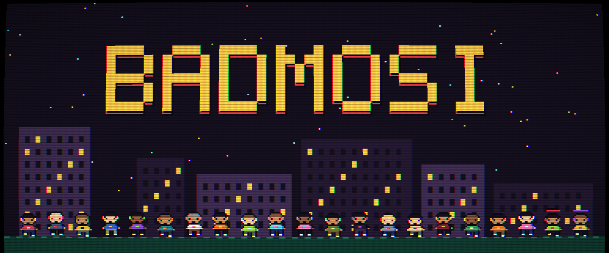

<div align="center">



# Badmosi

**A top-down pixel adventure set on the IIIT-B campus.** The Admin has brainwashed every club and put campus on lockdown. Your gang is the last one still free.

[](https://godotengine.org/download/archive/4.7.2-stable/)
[](scripts/)
[](#pixel-rules)
<br>
[](#pixel-rules)
[](#the-gang)
[](#the-clubs)
[](#controls)
<br>
[](CREDITS.md)
[](#running-and-building)

Synergy '26 Game Dev competition entry by Team Claude laggye.

</div>

## The story

It opens on a sepia flashback. Clubs used to run campus life: fest nights, 2 AM chai, pure badmosi. Then the Admin issued Circular No. 404 ("fun is pending approval"), brainwashed every club into enforcing its rules, and locked the campus down. Lifts fall, the lights go out, ceilings cave in, all "for your safety".

You pick one member of the Badmosi gang. Beat a club at its own game and it snaps out of it and joins you. Free all thirteen, then beat the SAC, then the Admin. The game ends with everyone eating at Corner House, then a report card: *Iss sem ki badmosi*.

Every club challenge is a minigame. At any moment you can hold **F** to say `F*** IT!` (censored by a pixel mosaic): the minigame shatters into pixels and turns into a beat 'em up fight with the whole club.

- Web build: _link added on submission day_
- Video: _link added on submission day_

## Where the code is

| Folder | What it holds |
|---|---|
| `scripts/autoload/` | `Px` (palette, sprites drawn from text, pixel font helpers), `Game` (run state, options, input map, saving), `Audio` (chiptune synth and beat clock), `Fx` (hitstop, shake, comic words, pixel bursts, telegraphs) |
| `scripts/fight/` | The player, the five enemy archetypes, club heads with eight shared attack pieces, the Admin's phases, the fight manager and attack tokens |
| `scripts/minigames/` | The base minigame (key card, penalties, timer, cursor) and one script per club game |
| `scripts/club_room.gd` | One scene for every club: challenge, minigame, F-it switch, fight, results, membership card, 8-Bit headline |
| `scripts/world/` | The room loader (text files) and the campus hub |
| `scripts/ui/` | HUD, menus, character select, pause, options, dialogue, name cards, result cards, credits |
| `scripts/story/` | Flashback, opening and the Corner House ending |
| `scripts/data/clubs.gd` | Every club's data: names, looks, palette, attacks, lines, headlines, ally perks |
| `scripts/data/roster.gd` | The 21 playable characters: looks, perks, quirks, theme songs |
| `levels/*.txt` | Club rooms, one character per tile (24 x 12) |
| `data/` | Quiz questions and DebSoc speech lines |
| `shaders/` | Mosaic transition, sprite flash and Downscale, club palette, CRT filter |
| `tools/` | Content checks, rule tests and the font builder |

## How to play

Play in the browser: https://paradox-73.github.io/Badmosi/ (rebuilt on every push to `main`).

Pick a character, then walk the campus. It follows the campus Keep Fit board: the main gate beside the football and cricket ground, the fountain lawn, Aryabhatta, the Visvesvaraya and Lilavati hostels with the koi pond between them, the basketball and volleyball/tennis courts, Ramanujan with the Thinker's statue facing the ground, and the MPH and Bhaskara block around one courtyard. The orange jogging track is the board's 1 km loop. Walk into a door to see the clubs inside; each board lists the MAIN clubs (needed for the SAC) before the SIDE clubs (optional, each frees an ally). Beat a club's game to free it and get its card. Free all thirteen to open the SAC room in the MPH; beat the SAC to open the Admin's office at Aryabhatta reception.

College life is the rule set:
- **Attendance** is your health. Every minigame mistake and every hit costs some. At 0% you are **DETAINED**, and the Admin emails your parents.
- A **Proxy** is an extra life: a friend marks you present.
- **Pixels (px)** are money. Spend them at the Bhaskara canteen, Coffee Cove, or on your phone.
- Each new club card is a **SEM UP**: more fight damage, smaller Attendance losses.
- Every 3 cards unlock a new fight special.

On campus:
- **Security guards** patrol the paths like Pac-Man ghosts. Get spotted on a path and they chase you. Caught means a loitering fine and a walk back to the gate.
- **Coffee Cove** (Aryabhatta and Ramanujan): cold coffee for speed, cappuccino for smaller Attendance losses, brownies to heal. Food buffs last until the end of your next club.
- **Your phone** (L, or Y on a pad): order Truffles or Juicy. A rider leaves the main gate 20 seconds later and walks to wherever you are. A Truffles burger is a full heal and more fight damage. Juicy is cheap and heals a little; sometimes it ends in *pet kharab*: slower, with washroom breaks.
- **The jogging track** has the board's 16 numbered posts. Touch all of them and get back to post 1 for a lap: +25 px and hype. The HUD shows how far you have walked.
- **Campus cats** wander the lawns. Walk into one to pet it. Some are rare; the report card counts how many kinds you found.
- **Visvesvaraya V121** was Badmosi's room. Nap on the bed for full Attendance (once per club beaten), or look at the photo on the wall to replay the flashback.
- On **8-BIT** difficulty the guards carry torches: they see a cone ahead of them, off the paths too, and the cone is drawn on the ground.
- The music speeds up when you are in trouble: low Attendance in a fight, the last 10 seconds of a minigame, or a guard on your tail. Rhythm games keep a steady tempo.

### Side clubs and committees

Optional. Each one you free becomes an ally with a small perk.

| Where | Clubs |
|---|---|
| Aryabhatta classrooms | Algo club, Quantum club, MOSFIT, E-Cell, Alfaaz, Chess club |
| Ramanujan classrooms | GDSC, Genesys, Lean-In, SquareOne, Turiya, ACM SIGCHI |
| MPH Symphony room | Synergy |
| Bhaskara mess | Aikyam, Prayas |
| Football and cricket ground | Sports committee: chase 26 off the last two overs |
| Basketball court | Basketball club: free throws on a power and arc meter |
| Volleyball and tennis court | Volleyball club (first to 5), Tennis club (one game, with deuce) |

### Quality of life

- Every minigame's key card waits for you to press J (or X/A) before the clock starts.
- Pausing stops the music, so the rhythm games don't count paused beats as misses. The pause menu has CONTROLS (the current minigame's goal and keys), FLIP THE TABLE, RESTART THIS CLUB, and asks before you leave a club or quit.
- The game pauses itself when the window or browser tab loses focus.
- On campus, I (or RB) opens a campus map with you, the guards and every door.
- The window opens at the largest sharp scale that fits your screen, so 1366 x 768 laptops get the whole game.
- The mouse pointer hides while you play with keys or a pad.

In fights, the Admin sabotages you every 15 seconds or so: a ceiling collapse, a falling lift, a power cut, the wifi going down (no specials), a random fine, or a fire extinguisher full of foam.

### Controls

| Action | Keys | Gamepad |
|---|---|---|
| Move | W A S D or arrow keys | Left stick or d-pad |
| Confirm in menus | J, Z or Enter | A / Cross |
| Back in menus | K, X or Esc | B / Circle |
| Attack (3-hit combo) | J, Z or Enter | X / Square |
| Dash (a dodge with a moment of safety) | K or X | A or B |
| Special | L or C | Y / Triangle |
| Switch special | I or V | Right bumper |
| Flip the table | Hold F for 1 second | Hold both triggers (LT + RT) |
| Pause | Esc | Start |
| Fullscreen | F11 | |

Each club head's name card lists its two attacks and how to beat each. Runs save to one of three slots; NEW GAME and LOAD GAME on the main menu ask which.

Each minigame shows its own keys on a key card before it starts. Menus, minigames and fights all work with a gamepad.

### The gang

21 characters, each with a theme song, buffs and nerfs. Four have a signature quirk.

| Character | Buffs | Nerfs | Signature |
|---|---|---|---|
| Aarpeet | +15% move speed, -30% dodge cooldown | +15% attendance loss | - |
| Ivan | +20% fight damage, -10% attendance loss | -10% move speed | - |
| Dhulli | +30% pixels earned, +20% minigame time | -10% fight damage | - |
| Gupta | -20% attendance loss, +15% pixels earned | -15% timing windows | - |
| Betala | +25% timing windows, +3 hype at fight start | -10% move speed | - |
| Kaushal | +15% fight damage, +10% move speed | -20% minigame time | - |
| Modi | +25% pixels earned, -10% attendance loss | +30% dodge cooldown | - |
| Sachan | -25% attendance loss, +10% fight damage | -5% move speed | Dhairya meter: every hit drains the patience. At zero: 6 s of rage, double damage. |
| Nikunj | +25% minigame time, +15% timing windows | -15% fight damage | - |
| Kanav | +10% fight damage, +10% move speed, +2 hype at fight start | +10% attendance loss | - |
| Jayant | +20% move speed, +2 hype at fight start | -20% pixels earned | - |
| Tyagi | -30% attendance loss, +1 hype at fight start | -15% move speed | - |
| Nirbhay | +10% fight damage, +1 hype at fight start | -15% minigame time | Black hole special: pulls every enemy in, then collapses. |
| Gary | -40% dodge cooldown, +10% move speed | +20% attendance loss | - |
| Mittal | +20% pixels earned, +15% timing windows | -10% fight damage | - |
| Antala | +25% fight damage | +30% dodge cooldown, -10% timing windows | - |
| Pratham | +20% minigame time, -15% attendance loss | -10% move speed | - |
| Suryans | +20% timing windows, +10% fight damage | -20% pixels earned | - |
| Bhavya | +15% move speed, +20% pixels earned, +1 hype at fight start | - | Phone buzz: the phone buzzes now and then. Press K in time to ignore it. |
| Sodhi | +10% move speed, -20% dodge cooldown | +10% attendance loss | Cartwheel special: cartwheels through a whole line of enemies. |
| Gathik | +3 hype at fight start, +10% fight damage | -15% minigame time | - |

### Speedrun

**Speedrun** on the main menu starts a run on SD with a timer on screen and skips the story scenes. The best time is saved.

### The clubs

| Club | Game | Pixel twist | Ally perk once freed |
|---|---|---|---|
| Impulse, the dance club | Dance-off: repeat COUNT EIGHT's arrow phrases on the beat | Arrows burst into pixels on a PERFECT | -20% dodge cooldown |
| Symphony, the music club | Piano tiles: each correct press plays the next note of Ode to Joy | Tiles shatter on a wrong note | +1 hype on every combo finisher |
| Quiz Society | Six questions, then a picture round | Pictures start as 4 x 4 blocks and sharpen | +15% minigame time |
| Pioneers, the maths club | Maths sprint, then make 404 from six numbers | Large pixel digits | +10% fight damage |
| 8-Bit, the student magazine | Proofread the cover | Find single wrong pixels | +10% move speed |
| ECLIPSE, the astronomy club | Telescope hunt in a dark sky | Single-pixel stars | shorter power cuts |
| Food Committee | 2 AM rush: build canteen trays | Pixel patience bars | +15% Attendance after every club you free |
| Chhayachitra, the photography club | Golden hour: shoot when the focus is sharp | Focus is a pulsing mosaic | +20% pixels earned |
| Film Division | Boom operator | Pixel frame edge | +10% timing windows |
| Zense, the developers' club | Bug squash, but green crawlers are features | Pixel-font code | shorter wifi outages |
| Vinci, the art club | Paint a pixel painting from memory | The whole game is pixel art | -10% Attendance loss |
| DebSoc, the debating society | Point of order: object only to fallacies | Pixel audience meter | halves every fine |
| Parvaaz, the theatre club | Stage fright: dodge the spotlights | Dithered pixel spotlights | +1 Proxy |
| The SAC | House rules that change every 10 seconds | Pixel rule banners | - |
| The Admin | Form 404: a quick round of each club's game, then a stamp | The Admin upscales itself into giant pixels | - |

Each freed club stays an ally for the rest of the run, so the order you free them in changes the run.

**Club select** on the main menu opens any club, the SAC or the Admin straight away, with either the minigame or the fight first. The pause menu has assists (invincible, double damage, skip club) with no penalty.

## Running and building

The project uses **Godot 4.7.2** (standard build, not .NET) with the Compatibility renderer.

1. Install Godot 4.7.2 from https://godotengine.org/download/archive/4.7.2-stable/ and its export templates.
2. Open `project.godot` in Godot, then press F5 to play.

Command line:

```
godot --path .
godot --headless --path . --export-release "Web" build/web/index.html
godot --headless --path . --export-release "Windows Desktop" build/win/Badmosi.exe
```

The web build is exported without thread support, so it runs on any static host such as itch.io or GitHub Pages.

### Checks

```
godot --headless --path . --script res://tools/check_scripts.gd
godot --headless --path . --script res://tools/check_levels.gd
godot --headless --path . --script res://tools/check_content.gd
godot --headless --path . --script res://tools/run_tests.gd
godot --headless --path . --script res://tools/ui_smoke.gd
```

These check that every script compiles, that the room files are valid, that the quiz, debate lines and club data are complete, that the game rules hold, and that the hub boards, canteen and pause menu work.

Arguments after `--` open a screen directly, for testing and frame captures: `--screen=<name>`, `--club=<id>`, `--fight` and `--autoplay`.

```
godot --path . --write-movie out/frames.png --fixed-fps 30 --quit-after 200 -- --screen=club --club=impulse --autoplay
```

## Pixel rules

- The game renders into a 384 x 216 viewport that is scaled up by whole numbers only, so every game pixel is a sharp square block: 4 x 4 in the default window, 5 x 5 at 1080p.
- An optional CRT filter (on by default) draws row gaps, a phosphor stripe, colour fringing and a vignette at window resolution, so it never blurs the game pixels. Its screen curve is a setting, from flat to 100%.
- Nearest-neighbour filtering everywhere, and pixel snapping on.
- One pixel size for sprites, tiles, UI, text and particles. The font is a 5 x 7 bitmap font built by `tools/make_font.py`.

## Credits

See [CREDITS.md](CREDITS.md). Every sprite, tile, font glyph, sound and music loop in the game was made by the team. Ode to Joy (Beethoven) is in the public domain.

All characters are invented. The Admin is a faceless office, not a person. No real student, faculty or staff member appears in the game.

## License

Code: MIT, see [LICENSE](LICENSE).
